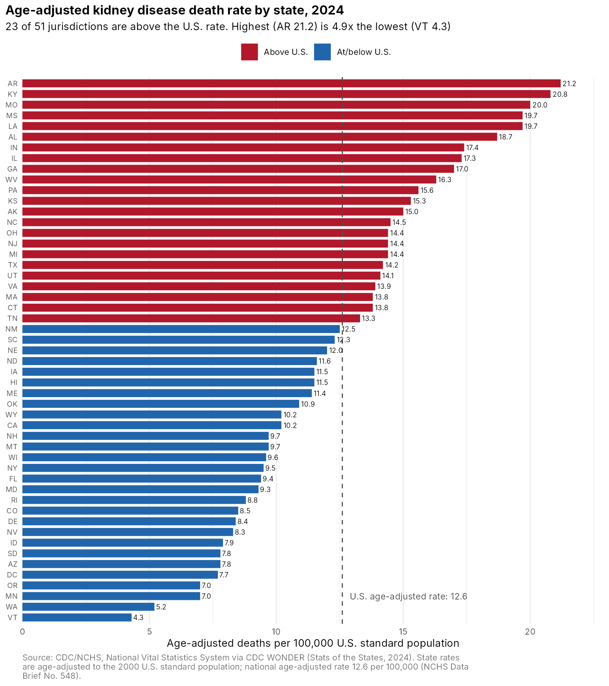

# U.S. Kidney Disease Mortality by State (2024)


## Key findings (2024)

- The U.S. age-adjusted kidney disease death rate was **12.6 per 100,000** in 2024 (down from 13.1 in 2023 and 13.0 in 2017). Kidney disease was the **8th leading cause of death**, with 55,081 deaths.
- **23 of 51 jurisdictions** (50 states + DC) are above the national rate.
- The highest rates are concentrated in the **mid-South**: Arkansas 21.2, Kentucky 20.8, Missouri 20.0, Louisiana 19.7, Mississippi 19.7, Alabama 18.7.
- The lowest are Vermont 4.3, Washington 5.2, Minnesota 7.0 and Oregon 7.0. The highest rate is **4.9×** the lowest.
- **Since 2017** (both years age-adjusted to the 2000 standard, so the comparison is like-for-like): the same Southern belt still leads. The largest moves were Delaware (16.1 → 8.4) and Alaska (9.9 → 15.0). Both have small numbers of deaths (131 and 103), so the change may reflect random variation or coding differences rather than a lasting trend. Don't read either as a confirmed improvement or deterioration.
- **Public-health takeaway:** screening and early kidney-care programmes (for diabetes and hypertension, the main drivers of chronic kidney disease) have the most room for impact in AR, KY, MO, LA, MS and AL.



## Data source and verification

| Item | Source |
|---|---|
| State rates and deaths, 2024 | CDC/NCHS [Stats of the States: Kidney Disease Mortality](https://www.cdc.gov/nchs/state-stats/deaths/kidney-disease.html) (NVSS via CDC WONDER), age-adjusted to the 2000 U.S. standard population |
| U.S. rate, 12.6 (age-adjusted) | [NCHS Data Brief No. 548](https://www.cdc.gov/nchs/data/databriefs/db548.pdf), Figure 4 |
| U.S. deaths (55,081) and rank (8th) | [CDC FastStats: Kidney Disease](https://www.cdc.gov/nchs/fastats/kidney-disease.htm) |
| 2017 comparison (`mortality_2017.csv`) | CDC dataset `bi63-dtpu` (all 51 values verified) |
| Boundaries | U.S. Census Bureau cartographic boundary file, 2018, 1:500k |

**Checks:** the 2024 values were copied from the CDC page's table view. The 51 state death counts add up to exactly **55,081**, CDC's national total. Each state's age-adjusted rate also sits in a plausible range relative to its crude rate.

**Benchmark note:** state rates are age-adjusted to the U.S. 2000 standard population. The national reference is therefore CDC's 2024 **age-adjusted** kidney disease death rate of **12.6** deaths per 100,000 standard population. FastStats' 16.2 deaths per 100,000 population is a **crude** rate and is not directly comparable.

**Stability note:** CDC cautions that rates for states with few deaths can be statistically unstable (e.g. AK, VT, WY, DC).

### Updating to a newer year

1. Replace `Year`, `DeathRate`, `Deaths` and `statescode` in `mortality.xlsx` (and `Mortality.csv`) with the new year's values from the Stats of the States page.
2. Set `US_RATE` in `KidneyDisease.R` to that year's **age-adjusted** national rate (from the NCHS "Mortality in the United States" data brief).
3. Run the script. Titles, colours and the ranked chart update automatically.

## Method

- The map colours each state relative to the U.S. rate: **red is above, blue is below**. That shows where the burden is unusually high, not just raw values.
- Alaska and Hawaii are shown as insets (not to scale). The far-western Aleutian Islands are left out of the inset.
- The script stops if the file doesn't have exactly the 50 states + DC, has duplicates, has missing or negative rates, or mixes years. It writes `data_validation_report.csv`.
- Projection: NAD83 / Conus Albers (EPSG:5070).

## Reproduce

```r
install.packages(c("tidyverse", "sf", "readxl"))
source("KidneyDisease.R")
```

Outputs: `Kidney Disease Map.png`, `kidney_disease_ranked.png`, `data_validation_report.csv`.

## Files

| File | Description |
|---|---|
| `KidneyDisease.R` | Validates the data, then draws the map and the ranked chart |
| `mortality.xlsx` | 2024 rates and deaths by state (the script's input) |
| `Mortality.csv` | Same data as plain text |
| `mortality_2017.csv` | Previous 2017 data, kept for comparison |
| `cb_2018_us_state_500k.*` | Census state boundaries |
| `Kidney Disease Map.png`, `kidney_disease_ranked.png` | Outputs |
| `data_validation_report.csv` | Validation summary |

## Limitations

- Age-adjusted rates remove differences in age structure but not other factors such as race/ethnicity mix, diabetes prevalence or access to dialysis.
- State rates are based on the underlying cause written on death certificates, and certification practices differ between states.
